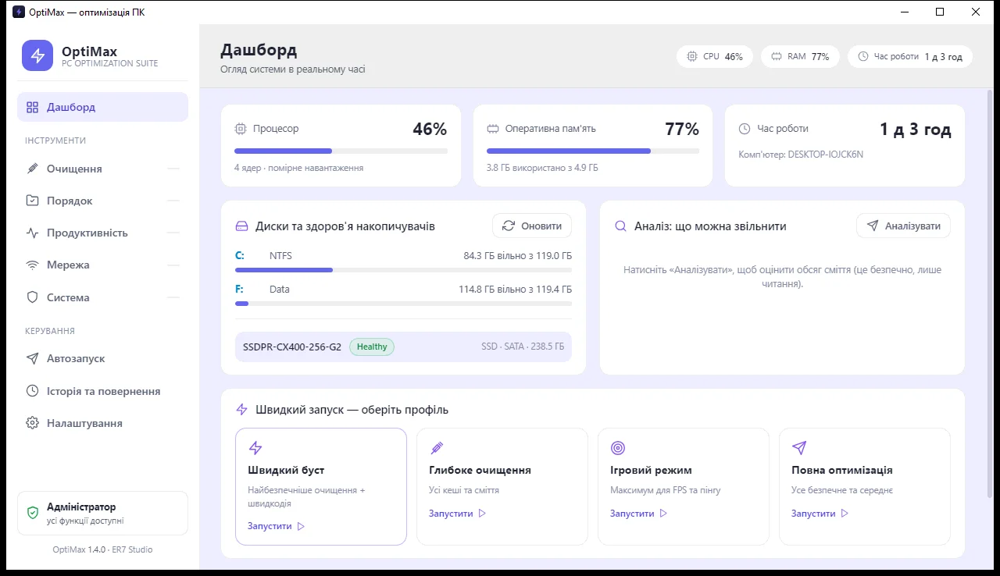
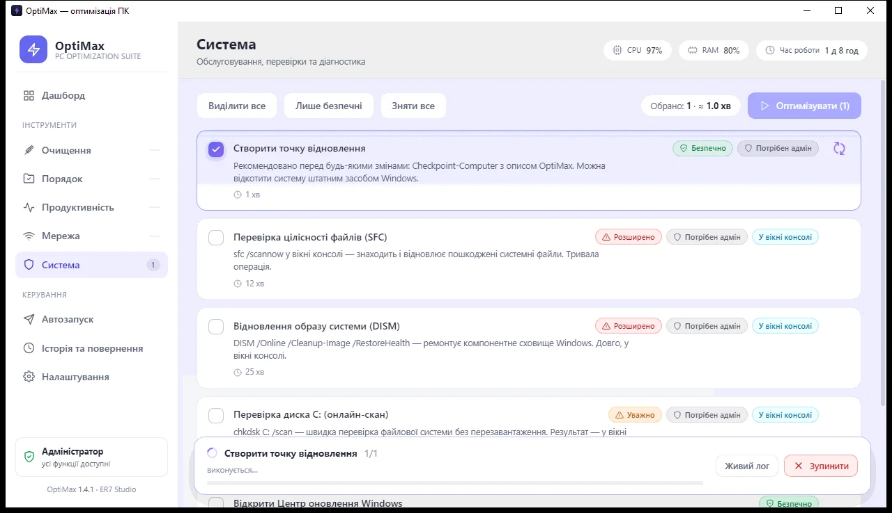
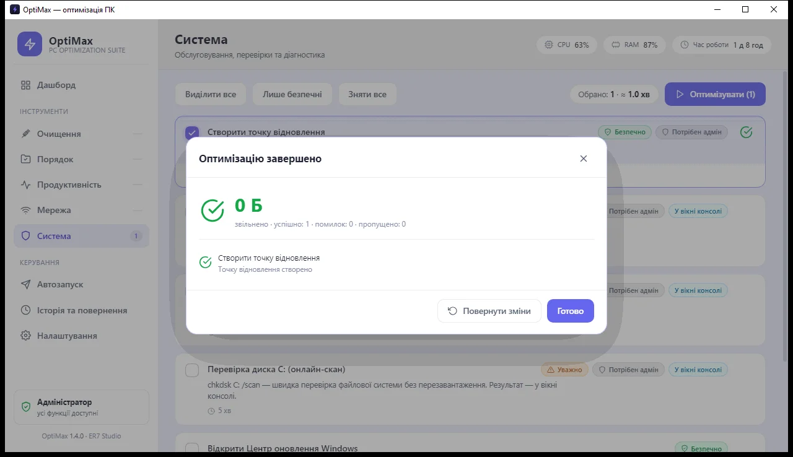
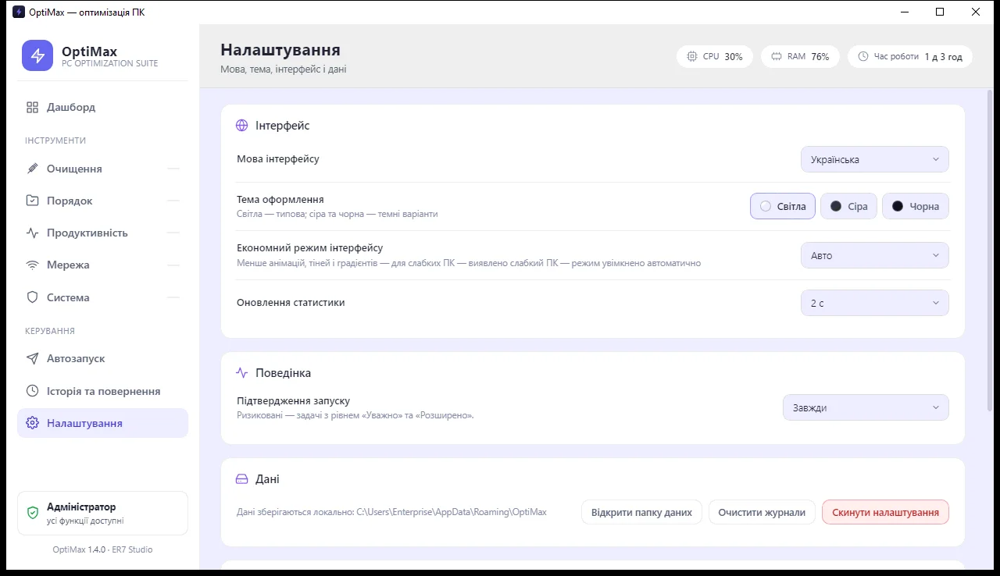
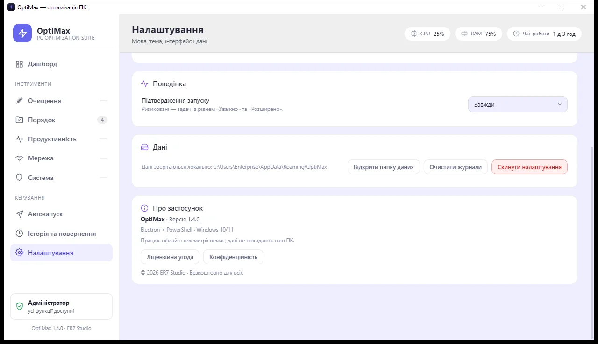
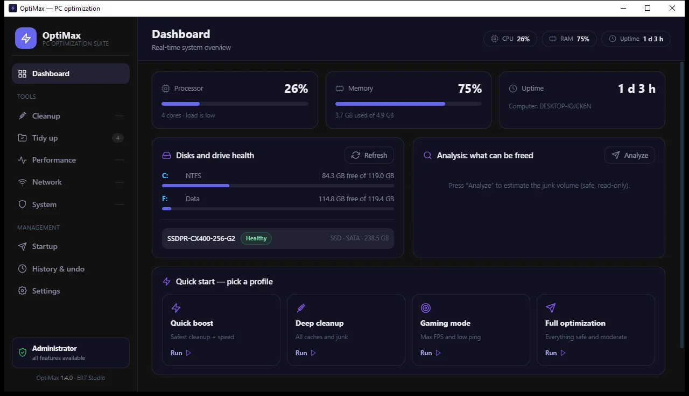
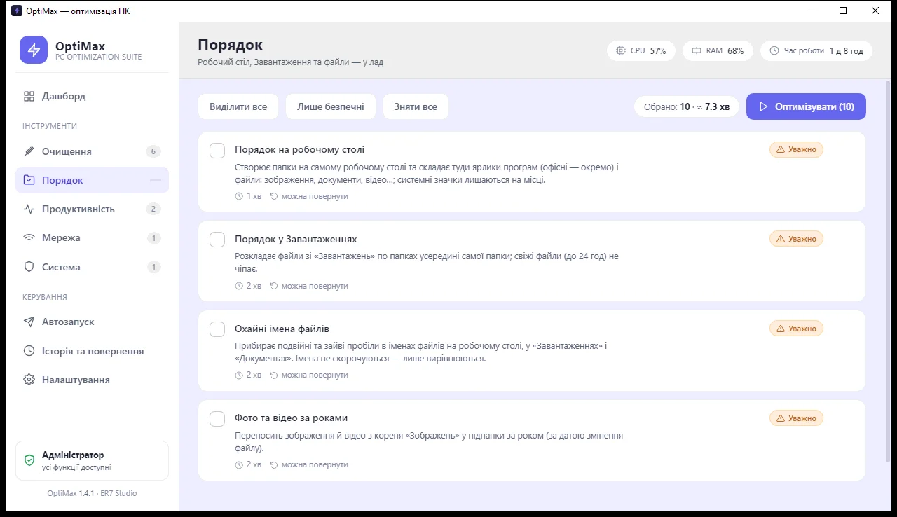
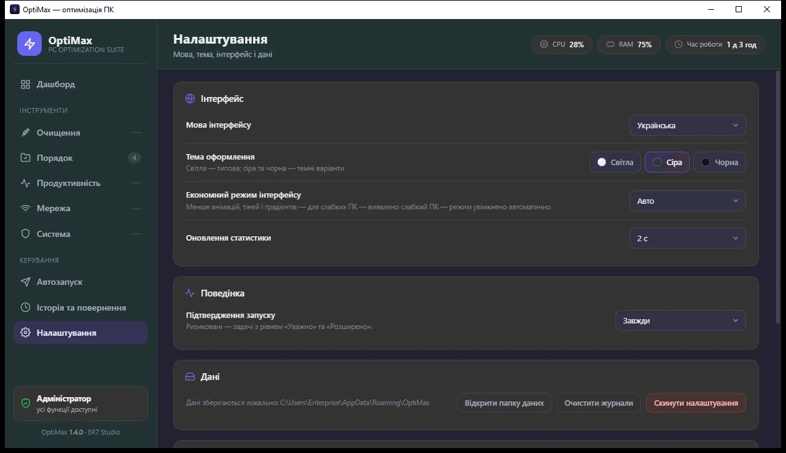
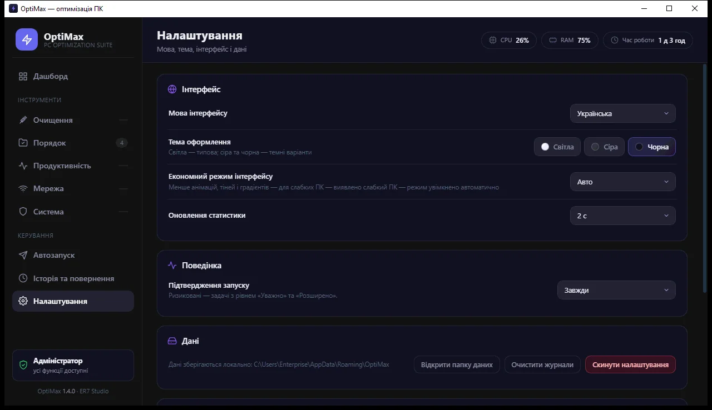

# OptiMax — оптимізація ПК

Професійний інструмент оптимізації Windows: очищення сміття, порядок у файлах, продуктивність,
мережеві твіки та обслуговування системи — з чекбоксами, профілями «в один клік» і повним відкатом змін.

**Версія 1.4.0** — повністю безкоштовний застосунок від **ER7 Studio** (подарунок для всіх): усі
35 задач і 4 профілі доступні без ключів, тріалів та оплат. Категорія «Порядок» (папки просто на
робочому столі та всередині «Завантажень», з undo), три теми оформлення, 5 мов інтерфейсу,
екран налаштувань, економний режим для слабких ПК.

**Стек:** Electron 31 + vanilla HTML/CSS/JS + Windows PowerShell 5.1 · **Платформа:** Windows 10/11 x64 ·
**Ліцензія:** MIT (код) · EULA (застосунок, `docs/EULA.md`)

| Головний екран | Прогін у дії | Результат |
|---|---|---|
|  |  |  |

| Налаштування | Про застосунок | English UI | Категорія «Порядок» |
|---|---|---|---|
|  |  |  |  |

| Тема: сіра | Тема: чорна |
|---|---|
|  |  |

> Тема **світла** — типова (див. скріншоти вище). Усі три перемикаються миттєво в
> «Налаштування → Тема» та зберігаються.

## Можливості

- **35 задач у 5 категоріях** — Очищення, Порядок, Продуктивність, Мережа, Система.
- **Чекбокси для всього** — «Виділити все», «Лише безпечні», «Зняти все», лічильник обраного та оцінка часу.
- **4 профілі в один клік:** Швидкий буст (9), Глибоке очищення (10), Ігровий (8), Повний (17).
- **Категорія «Порядок»** — папки створюються просто на робочому столі: ярлики програм
  (офісні — в «Офісні програми», решта — в «Програми») і файли розкладаються по типах
  (Зображення, Документи, Відео…); у «Завантаженнях» — так само, папки всередині самої папки.
  Системні значки («Цей ПК», «Завантаження», Кошик) не чіпаються. Ще: охайні імена файлів
  (подвійні пробіли, NBSP) і фото та відео за роками. Кожне переміщення фіксується undo-записом
  `filemove` — усе повертається однією кнопкою.
- **Повний відкат** — кожна зміна реєстру/служби/схеми живлення/DNS/задачі фіксується в `restore.json`
  і повертається з екрана «Історія та повернення».
- **Дашборд у реальному часі** — CPU/RAM/диски, Uptime, аналіз сміття з порадами.
- **Менеджер автозапуску** — увімкнення/вимкнення елементів (механізм StartupApproved, як у Task Manager).
- **Рівні ризику** — Безпечно / Уважно / Розширено, з бейджем «Потрібен адмін» і підвищенням прав через UAC.
- **Консольні задачі** (SFC, DISM, chkdsk, WinSxS) — виконуються у видимому вікні PowerShell, черга чекає закриття.
- **Живий лог і скасування** — прогрес по кожній задачі, стоп із коректним завершенням.
- **5 мов інтерфейсу** — українська (типово), англійська, польська, німецька, російська;
  перемикання в «Налаштування → Мова».
- **Безкоштовно для всіх** — усі 35 задач і 4 профілі доступні кожному: без ключів, тріалів
  і оплат. Застосунок створено **ER7 Studio** як подарунок — користуйтесь із задоволенням.
- **Екран налаштувань** — мова, тема, економний режим, інтервал статистики, підтвердження запуску,
  керування даними, EULA та політика конфіденційності.
- **Три теми оформлення** — світла (типова), сіра та чорна; перемикач у Налаштуваннях,
  застосовується миттєво та зберігається; працює разом з економним режимом.
- **Економний режим для слабких ПК** — автовизначення (≤4 ядер CPU або ≤6 ГБ RAM), вимикає анімації,
  тіні й градієнти; вмикається автоматично, можна зафіксувати вручну.

## Безкоштовно для всіх

OptiMax — **безкоштовний** застосунок від **ER7 Studio**. Ніяких ключів, активацій, тріалів чи
підписок: усі 35 задач, усі 4 профілі, усі теми й мови відкриті кожному з першого запуску.
Це подарунок — просто користуйтесь.

- Працює повністю офлайн: без телеметрії, акаунтів і мережевих запитів.
- Зміни системи фіксуються undo-записами й повертаються однією кнопкою.
- Умови використання — `docs/EULA.md`; обробка даних — `docs/PRIVACY.md`.

Якщо застосунок став у пригоді — подякуйте добрим словом і передайте його далі. 💙

## Швидкий старт

**Вимоги:** Windows 10/11 (x64) · PowerShell 5.1 (вбудований у систему) ·
для розробки — Node.js **≥ 20** (CI перевіряє на 20.x і 22.x; `.nvmrc` — 22).

**Готовий portable-застосунок** (нічого встановлювати не треба):

```
release\OptiMax-win32-x64\OptiMax.exe
```

Запускати бажано **від імені адміністратора** — інакше частина задач буде пропущена
(застосунок сам запропонує перезапуск із підвищенням прав). Усі функції доступні одразу —
застосунок повністю безкоштовний, без реєстрацій і ключів.

**Із вихідників:**

```powershell
npm install        # один раз
npm start          # запуск у dev-режимі
```

## Каталог задач

### Очищення (10)
| Задача | Риск | Адмін | Примітка |
|---|---|---|---|
| Тимчасові файли користувача | Безпечно | | `%TEMP%`, зайняті файли пропускаються |
| Тимчасові файли Windows | Безпечно | ✓ | `C:\Windows\Temp` |
| Кошик | Безпечно | | усі диски |
| Кеш браузерів (Edge, Chrome) | Безпечно | | кукі та паролі не чіпає |
| Кеш мініатюр Проводника | Безпечно | | |
| Дампи збоїв і звіти помилок | Безпечно | ✓ | |
| Кеш Windows Update | Уважно | ✓ | |
| Prefetch | Уважно | ✓ | |
| Windows.old | Уважно | ✓ | попередня інсталяція |
| Очищення WinSxS (DISM) | Уважно | ✓ | у вікні консолі |

### Порядок (4)
| Задача | Риск | Адмін | Примітка |
|---|---|---|---|
| Порядок на робочому столі | Уважно | | папки прямо на столі: ярлики програм (офісні — окремо) + файли за типами; системні значки не чіпає |
| Порядок у Завантаженнях | Уважно | | папки всередині «Завантажень»; свіжі файли (до 24 год) не чіпає |
| Охайні імена файлів | Уважно | | подвійні пробіли та NBSP → один; робочий стіл, Завантаження, Документи |
| Фото та відео за роками | Уважно | | корінь «Зображень» → підпапки за роком (дата змінення) |

### Продуктивність (10)
| Задача | Риск | Адмін | Примітка |
|---|---|---|---|
| Схема живлення «Максимальна продуктивність» | Безпечно | ✓ | з undo |
| Візуальні ефекти → швидкодія | Безпечно | | |
| Затримка меню та анімації | Безпечно | | |
| Ігрові твіки (Game Mode + Game DVR off) | Безпечно | | |
| Телеметрія Windows | Уважно | ✓ | |
| Фонові застосунки UWP | Уважно | ✓ | |
| Вимкнути гібернацію | Уважно | ✓ | звільняє `hiberfil.sys`, з undo |
| Апаратне планування GPU (HAGS) | Розширено | ✓ | |
| Служба SysMain (SuperFetch) | Розширено | ✓ | з undo |
| Вимкнути індексацію пошуку | Розширено | ✓ | з undo |

### Мережа (6)
| Задача | Риск | Адмін | Примітка |
|---|---|---|---|
| Очистити кеш DNS | Безпечно | | DNS + NetBIOS |
| Скинути DNS до автоматичного | Безпечно | ✓ | |
| Оптимізація TCP | Уважно | ✓ | з undo (netsh) |
| Швидкий DNS (Cloudflare 1.1.1.1) | Уважно | ✓ | попередні DNS запам'ятовуються |
| Вимкнути алгоритм Nagle | Розширено | ✓ | з undo |
| Скидання стеку Winsock | Розширено | ✓ | потрібен перезапуск |

### Система (5)
| Задача | Риск | Адмін | Примітка |
|---|---|---|---|
| Створити точку відновлення | Безпечно | ✓ | рекомендовано перед змінами |
| Перевірка цілісності файлів (SFC) | Розширено | ✓ | у вікні консолі |
| Відновлення образу системи (DISM) | Розширено | ✓ | у вікні консолі |
| Перевірка диска C: (онлайн-скан) | Уважно | ✓ | у вікні консолі |
| Відкрити Центр оновлення Windows | Безпечно | | |

## Безпека та відкат

- Перед змінами рекомендується задача **«Створити точку відновлення»**.
- Кожен скрипт повертає undo-записи (`reg`, `service`, `powerplan`, `dns`, `task`, `hibernate`, `netsh-tcp`, `filemove`);
  вони накопичуються в `%APPDATA%\OptiMax\restore.json`.
- Кнопка **«Повернути зміни»** в модалці результату та екран **«Історія та повернення»**
  виконують відкат через `core/scripts/undo/restore.ps1`.
- Дані застосунку: `%APPDATA%\OptiMax\` — `settings.json`, `restore.json`, `logs\optimax-*.log`, `tmp\`.

## Для розробників

```powershell
npm start                                  # dev-запуск
npm test                                   # node:test: 25/25 (каталог, контракти скриптів, store, черга виконання, i18n)
npm run test:ui                            # smoke-тест інтерфейсу (Electron, приховане вікно + мок-API)
npm run test:e2e                           # e2e: справжній preload + IPC + ядро (фейковий PowerShell)
npm run verify                             # тести + цілісність UI + JS-гейт + синтаксис PowerShell
npm run test:order                         # пісочниця «Порядку»: переміщення + undo на фейкових теках
npm run mock                               # UI у браузері: http://127.0.0.1:8899/src/ui/index.html
npm run package                            # portable-збірка (іконка → packager → version info)
node tools/run-task.js <taskId>            # прогін однієї задачі як у застосунку (з undo/логом)
powershell -File tools/shot.ps1 -Out shot.png -ProcessName OptiMax   # скріншот вікна (PrintWindow)
```

Mock-режим у браузері підтримує `?theme=light|gray|black`, `?autorun=1`, `?noadmin=1`;
мова мока перемикається як у застосунку. Для демо-станів реального застосунку:
`node tools/patch-settings.js theme=black lastView=cleanup locale=en`.

### Збірка portable-версії

```powershell
npm run package   # іконка → electron-packager → вшивання іконки/версії (resedit)
```

Результат: `release\OptiMax-win32-x64\` — розповсюджується як є (запуск `OptiMax.exe`).

> **Важливо (сумісність зі старими машинами):**
> Electron запінено на **31.7.7** — новіші версії (44+) вимагають VC++ runtime, якого на цільовій
> машині немає. Крім того, `@electron/packager` використовує native-модуль `@electron-internal/extract-zip`,
> якому теж потрібні `msvcp140.dll` / `vcruntime140.dll` / `vcruntime140_1.dll` — без інсталятора VC++ їх можна
> скопіювати в `node_modules\@electron-internal\extract-zip\` (наприклад, з `C:\Program Files (x86)\Microsoft\EdgeCore\<ver>\`).
> Вшивання іконки та version info виконує `tools/embed-icon.js` (resedit — чистий JS, без native-залежностей).

## Структура проєкту

```
OptiMax/
├─ src/
│  ├─ main.js, preload.js     # Electron: вікно, IPC (whitelist каналів), single-instance, UAC
│  ├─ core/
│  │  ├─ tasks.js             # єдине джерело правди: 35 задач + 4 профілі (тексти — через i18n)
│  │  ├─ runner.js            # черга, прогрес, cancel, undo-записи, summary
│  │  ├─ ps.js                # запуск PowerShell 5.1 (прихований/консольний), PRELUDE-хелпери
│  │  ├─ store.js             # settings.json / restore.json / логи / tmp, DEFAULT_SETTINGS
│  │  ├─ i18n.js              # локалізація (5 мов: uk/en/pl/de/ru)
│  │  ├─ locales/             # uk/en/pl/de/ru.json — 270 ключів кожен
│  │  ├─ stats.js, startup.js # жива статистика; менеджер автозапуску
│  │  └─ scripts/             # 39 PS-скриптів: cleanup/ order/ perf/ network/ system/ undo/ startup/
│  └─ ui/                     # index.html, styles.css, js/ (9 модулів; vanilla, mock-режим для браузера)
├─ site/                      # лендінг-сторінка продукту (статична, деплой на Vercel)
├─ assets/                    # іконки застосунку (ico/png)
├─ tools/                     # dev-інструменти: run-task, serve-ui, check-ui, check-ps-syntax,
│                             # test-order, make-icon, embed-icon, patch-settings, скріншоти
├─ tests/                     # node:test (tasks, store, runner, i18n) + smoke-тест UI (tests/smoke)
├─ docs/                      # PRD, ARCHITECTURE, RULES, DESIGN, TASKS, MEMORY, EULA, PRIVACY + screens/
└─ release/OptiMax-win32-x64/ # зібраний portable-застосунок (не в git)
```

## Документація

| Документ | Про що |
|---|---|
| [`docs/README.md`](docs/README.md) | покажчик усієї документації |
| [`docs/REFERENCE.md`](docs/REFERENCE.md) | карта тек і модулів, IPC-канали, схема задач, файли даних |
| [`docs/ARCHITECTURE.md`](docs/ARCHITECTURE.md) · [`docs/DECISIONS.md`](docs/DECISIONS.md) | архітектура та журнал рішень (ADR) |
| [`docs/TESTING.md`](docs/TESTING.md) | команди перевірок, покриття, прогалини |
| [`docs/SECURITY.md`](docs/SECURITY.md) · [`SECURITY.md`](SECURITY.md) | модель безпеки, секрети, ризики · як повідомити про вразливість |
| [`docs/DEPLOY.md`](docs/DEPLOY.md) | публікація (GitHub, Vercel, релізний архів) |
| [`docs/TECH-DEBT.md`](docs/TECH-DEBT.md) | відомі проблеми та беклог за пріоритетами |
| [`CONTRIBUTING.md`](CONTRIBUTING.md) · [`CHANGELOG.md`](CHANGELOG.md) | як долучитися · історія версій |

## Типові проблеми

| Симптом | Причина | Що робити |
|---|---|---|
| Частина задач «пропущена» або позначена як недоступна | застосунок запущено без прав адміністратора | натиснути «Підвищити» в застосунку або запустити `OptiMax.exe` від імені адміністратора |
| Черга «завмерла» на задачі SFC/DISM/chkdsk/WinSxS | консольна задача виконується у видимому вікні PowerShell | закрити вікно консолі — черга продовжиться |
| `npm run package` падає на розпакуванні Electron | `@electron-internal/extract-zip` потребує VC++ DLL | скопіювати `msvcp140.dll`, `vcruntime140.dll`, `vcruntime140_1.dll` у `node_modules\@electron-internal\extract-zip\` (див. розділ «Збірка») |
| Зміни не повертаються | журнал відкатів очищено | повернення можливе лише для записів, які є в `%APPDATA%\OptiMax\restore.json` |
| `npm run verify` падає на `check:ui` | у словнику бракує ключа або зайвий | вирівняти `src/core/locales/*.json` (усі 5 мов мусять мати однакові ключі) |
| Скріншоти вікна порожні | PrintWindow віддає застарілий кадр | використовувати `tools/shot.ps1` (пауза + подвійний захват), вікно має бути на передньому плані |

## Ліцензія та участь

- Код — **MIT** (файл `LICENSE`); застосунок — безкоштовний, умови використання в `docs/EULA.md`.
- Як долучитися (правила, структура, як додати задачу) — `CONTRIBUTING.md`.
- Історія версій — `CHANGELOG.md`. Питання безпеки — `SECURITY.md`.
- Лендінг продукту — `site/`.
- Публікація (GitHub + Vercel) — `docs/DEPLOY.md`.

## Посилання

| Що | Де |
|---|---|
| 🌐 Сайт продукту | **https://optimax-ua.vercel.app** (проєкт `optimax-ua` на Vercel) |
| Локально | `npm run site` → http://127.0.0.1:8902/ |
| Репозиторій | **https://github.com/enterpriseimpossible-sudo/optimax** (публічний, MIT) |
| Завантажити | **[GitHub Releases → OptiMax 1.4.0](https://github.com/enterpriseimpossible-sudo/optimax/releases/latest)** (`OptiMax-1.4.0-win-x64.zip`, 105.6 МБ) |


## Перевірено на реальній машині

- Синтаксис **39/39** PS-скриптів — без помилок.
- **25/25** тести `node:test`: каталог задач і контракти скриптів, сховище, **черга виконання**
  (статуси, undo, скасування, помилки, URI-задачі, консольні задачі, живий лог), локалізація.
- **Smoke-тест інтерфейсу** (`npm run test:ui`) — справжній рендерер Electron у прихованому вікні:
  ініціалізація, навігація, категорія «Порядок», вибір задачі, налаштування, теми, 0 помилок консолі.
- **E2e-тест містка** (`npm run test:e2e`) — справжній `preload` + IPC + ядро: каталог, налаштування
  пишуться у реальний `settings.json`, прогін задач із push-подіями `run:event`, undo у `restore.json`,
  білий список каналів і заборонені зовнішні адреси (20 перевірок).
- Цілісність UI: **270 ключів × 5 мов** без розбіжностей, усі ключі з коду/HTML наявні в словниках,
  усі id елементів збігаються з `index.html` (`node tools/check-ui.js`; 231 ключ коду, 44 `data-i18n`, 74 id).
- `npm run verify` — об'єднує тести, цілісність UI, JS-гейт, синтаксис PowerShell і smoke-тест (CI виконує саме його).
- Реальні прогони: кеш DNS, тимчасові файли, реєстровий undo round-trip (зміна → відкат → як було).
- **Повний прогін у запакованому застосунку: 30/30 успішно, 117.4 МБ звільнено, 0 помилок, 0 пропущено.**
- **v1.4.0 — безкоштовно від ER7 Studio:** ліцензування Free/тріал/PRO (ключі, активація, гейтинг,
  менеджер ключів) прибрано повністю; усі 35 задач і 4 профілі відкриті кожному. У Налаштуваннях —
  напис «© 2026 ER7 Studio · безкоштовно для всіх», у сайдбарі — «OptiMax 1.4.0 · ER7 Studio».
  Категорію «Порядок» перероблено: папки створюються просто на робочому столі, ярлики програм
  (офісні — окремо) теж сортуються, системні значки лишаються; у «Завантаженнях» — так само всередині папки.
  Пісочниця `node tools/test-order.js` — 45/45 перевірок (переміщення + undo round-trip, зокрема ярликів).
- **v1.3.0 — теми:** світла (типова), сіра та чорна; кольори повністю переведено на CSS-змінні
  (фон, панелі, модалки, бейджі, скролбар), перемикання миттєве й зберігається в settings.json;
  mock підтримує `?theme=`, перевірено у браузері та на реальному вікні — скріншоти в `docs/screens/`.
- **v1.2.0 — «Порядок»:** усі 4 задачі перевірено у пісочниці (`node tools/test-order.js`) —
  розкладання по папках, пропуск системних файлів і свіжих завантажень, нормалізація імен
  і розкладка фото за роками; кожен крок повертається undo-ом (`filemove` round-trip).
- **v1.1.0 у застосунку:** екран налаштувань, перемикання мов (uk/en), економний режим
  (авто-увімкнення на i3-2330M / 5 ГБ RAM) — перевірено скріншотами `docs/screens/`.
