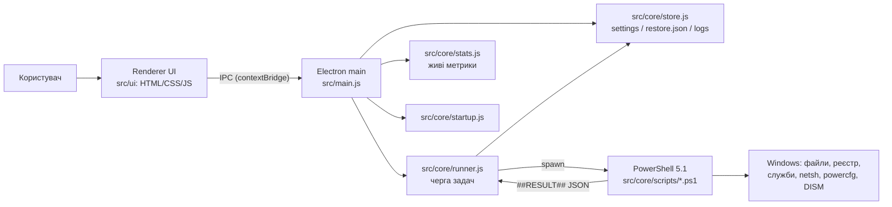

# ARCHITECTURE — OptiMax

## 1. Загальна схема


## 2. Стек технологій
| Шар | Технологія | Чому |
|---|---|---|
| Оболонка | Electron (Node 24) | Стандартний десктоп-стек, багате вікно |
| UI | Vanilla HTML + CSS + JS | Без бандлера, швидко, легко читати |
| Логіка системи | Windows PowerShell 5.1 (вбудований) | Доступ до реєстру/служб/DISM без залежностей |
| Зберігання | JSON у `%APPDATA%/OptiMax` | Simple, прозоро, без БД |
| Пакування | @electron/packager → portable .exe | Портативна збірка для Windows x64 |

## 3. Структура
```
OptiMax/
  src/main.js          # Electron main: вікно, IPC, elevation, single-instance
  src/preload.js       # contextBridge API (безпечний місток)
  src/core/
    tasks.js           # каталог задач + профілі
    runner.js          # черга, прогрес, скасування, логи
    ps.js              # запуск PowerShell (encoded), console-задачі
    stats.js           # CPU/RAM (os) + диски/SMART (ps, кеш 15с)
    store.js           # settings.json, restore.json, logs/
    i18n.js            # локалізація (5 мов) + locales/*.json
    startup.js         # список автозапуску + toggle
    scripts/           # .ps1 на кожну задачу + undo/restore.ps1
  src/ui/              # index.html, styles.css, app.js
  site/                # лендінг-сторінка продукту (деплой на Vercel)
  tests/               # node --test
  tools/               # dev-інструменти та перевірки
  docs/                # ці документи
```

## 4. Контракт PS-скрипта
- Скрипт друкує довільні рядки (→ лог) і останнім рядком: `##RESULT## {"ok":true,"message":"…","freedBytes":0,"undo":[…],"details":{…}}`
- `undo[]` — записи для повернення (kind: reg | service | powerplan | dns | files | task | cmd).
- Timeout і скасування — у `runner.js` (taskkill /T /F).
- Console-задачі (SFC, DISM, chkdsk) відкриваються у видимому вікні; runner чекає закриття.
